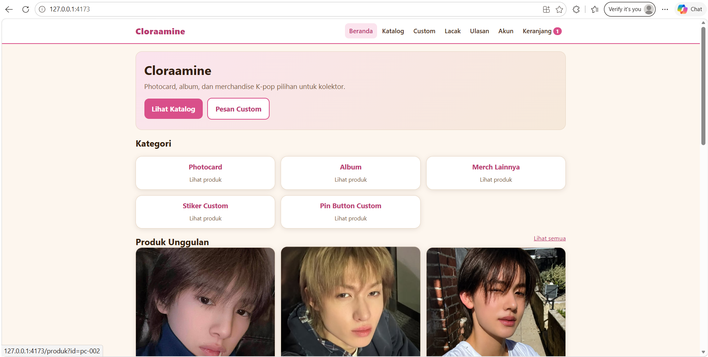
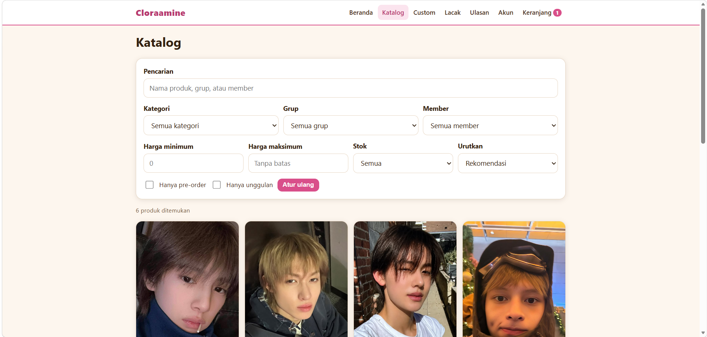
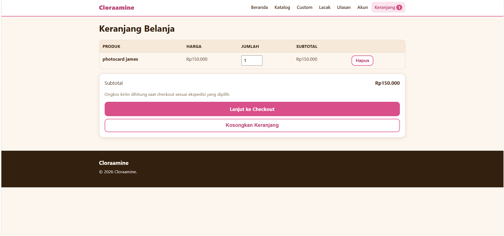
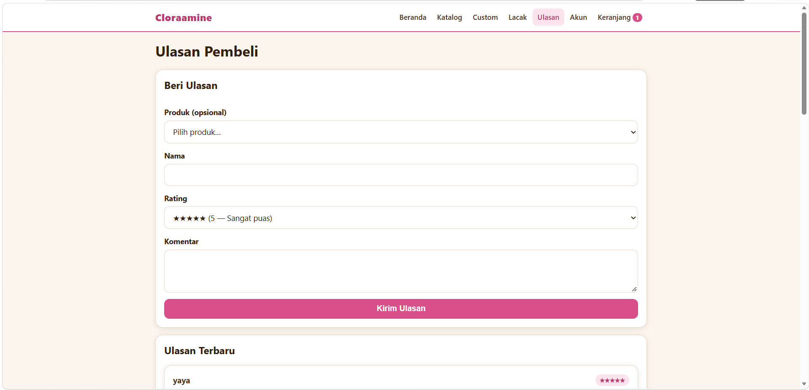

# Cloraamine

Aplikasi web toko **Cloraamine** — menjual photocard, album K-pop, merchandise K-pop lainnya,
stiker custom, dan pin button custom. Dibangun mobile-first dan dapat dipasang di layar utama
sebagai PWA sederhana.

- **Front-end:** HTML, CSS, JavaScript murni (tanpa framework).
- **Back-end:** Node.js + Express.
- **Data:** SQLite (better-sqlite3).
- **Bahasa:** seluruh teks antarmuka berbahasa Indonesia formal dan netral.

> ⚠️ Seluruh harga, stok, nomor WhatsApp, rekening, ongkos kirim, dan akun media sosial pada
> data awal adalah **DATA CONTOH** (ditandai `CONTOH`). Ganti dengan data sebenarnya sebelum
> digunakan produksi.

## Cara Menjalankan

```bash
cd cloraamine
npm install
node tools/generate-icons.js   # membuat ikon PWA + gambar QRIS contoh (sekali saja)
npm start
```

Buka <http://127.0.0.1:4173>. Database SQLite dibuat dan di-seed otomatis saat pertama dijalankan
(berkas `data/cloraamine.db`).

### Uji alur

Dengan server berjalan, jalankan di terminal terpisah:

```bash
npm run uji   # node tools/uji-alur.js
```

Uji mencakup checkout, unggah bukti bayar, masuk & riwayat dashboard pelanggan, pesanan
custom (komentar, tinjauan admin, persetujuan produksi), perubahan status, ekspor CSV,
QR Code, proteksi rute admin/unggahan, alamat tersimpan, wishlist, ubah profil/ganti sandi,
pindah akun, detail pesanan & riwayat pelanggan, sembunyikan/hapus ulasan, pengalihan halaman
`/admin`, serta ketersediaan seluruh halaman.

> Catatan: percobaan masuk admin dan pelanggan dibatasi 5 kali per 15 menit per alamat IP.
> Bila menjalankan `npm run uji` beruntun lebih dari sekali dalam rentang waktu tersebut,
> restart server terlebih dahulu agar penghitung batas diatur ulang.

> **Catatan Node.js:** proyek ini diuji dengan Node.js 18.17+ / 24. Bila `better-sqlite3`
> gagal dipasang di Windows, hapus `better-sqlite3` dan sesuaikan lapisan data pada
> `data/db.js` dengan berkas JSON — struktur API tidak berubah.

## Pengaturan `.env`

Salin `.env.example` menjadi `.env` lalu isi:

| Kunci            | Keterangan                                                             |
| ---------------- | ---------------------------------------------------------------------- |
| `PORT`           | Port server (default `4173`)                                           |
| `ADMIN_EMAIL`    | Email untuk masuk dashboard `/admin` (default `admin@cloraamine.test`) |
| `ADMIN_PASSWORD` | Kata sandi dashboard `/admin` — **wajib diganti**                      |
| `WA_PENJUAL`     | Nomor WhatsApp penjual untuk tautan "Hubungi Penjual"                  |
| `QRIS_PAYLOAD`   | Payload QRIS statis dari aplikasi pembayaran Anda                      |

Data lain (rekening transfer, ongkos kirim ekspedisi, media sosial, tarif custom, data produk)
diubah melalui file konfigurasi:

- `data/pengaturan.js` — slogan, WhatsApp, rekening, QRIS, ekspedisi, **media sosial**
  (seluruh akun media sosial ditulis di file ini saja; TikTok dan Instagram memakai handle
  **@cloraamine**)
- `data/produk.js` — kategori & produk contoh (dipakai saat seed pertama kali)
- `data/tarif-custom.js` — tarif custom (ukuran, bahan, bentuk, tingkat jumlah, jumlah minimal)

Setelah mengubah `data/produk.js`, hapus `data/cloraamine.db` lalu jalankan ulang server untuk
meng-seed ulang (atau kelola produk lewat dashboard admin).

## Struktur Folder

```
cloraamine/
├── server.js              # Server Express: statis, API, proteksi unggahan
├── routes/
│   ├── produk.js          # API katalog, filter, detail, pengaturan
│   ├── pesanan.js         # API checkout, bukti bayar, pelacakan, ulasan
│   ├── custom.js          # API pesanan custom: tarif, desain, status, komentar
│   ├── akun.js            # API akun: daftar, masuk, keluar, profil, ganti sandi, alamat, wishlist
│   ├── pelanggan.js       # API dashboard pelanggan: riwayat, ringkasan
│   ├── notifikasi.js      # API notifikasi in-app (admin & pelanggan)
│   ├── admin.js           # API admin: produk, pesanan, laporan, ulasan, riwayat pelanggan, akun admin, ekspor CSV
│   └── qr.js              # Generator QR Code PNG menuju URL
├── lib/
│   ├── auth.js            # Hash sandi, sesi admin & akun, token pembeli, proteksi unggahan
│   ├── notifikasi.js      # Penyimpanan & pembacaan notifikasi
│   └── validasi.js        # Validasi input sisi server
├── data/
│   ├── db.js              # Skema SQLite + seed
│   ├── produk.js          # Data produk CONTOH
│   ├── tarif-custom.js    # Tarif custom CONTOH
│   ├── pengaturan.js      # Pengaturan toko CONTOH
│   └── cloraamine.db      # Database (di-ignori git)
├── public/
│   ├── index.html         # Beranda
│   ├── katalog.html       # Katalog + pencarian + filter
│   ├── produk.html        # Detail produk
│   ├── keranjang.html     # Keranjang belanja
│   ├── checkout.html      # Checkout + pembayaran + bukti bayar
│   ├── lacak.html         # Pelacakan pesanan + persetujuan/komentar custom
│   ├── akun.html          # Pilih peran (Admin/Pelanggan), login, dashboard pelanggan
│   ├── custom.html        # Pesanan custom + pratinjau desain
│   ├── ulasan.html        # Ulasan rating 1–5 + media sosial
│   ├── admin.html         # Dashboard admin (/admin)
│   ├── manifest.json      # Manifest PWA
│   ├── sw.js              # Service worker PWA
│   ├── css/style.css      # Gaya (pink, krem, cokelat)
│   ├── js/                # util.js (API client, keranjang)
│   └── img/               # Ikon PWA, placeholder, QRIS contoh
├── uploads/               # Unggahan (di-ignori git; hanya admin/pemilik yang boleh akses)
├── tools/generate-icons.js# Pembuat ikon PWA + QRIS contoh
└── .env.example
```

## Alur Utama

### Pembeli

1. **Beranda** → nama toko, slogan, kategori, produk unggulan.
2. **Katalog** → 5 kategori (Photocard, Album, Merch Lainnya, Stiker Custom, Pin Button Custom)
   dengan pencarian serta filter kategori, grup, member, harga, dan stok.
3. **Detail produk** → foto (kartu photocard berefek zoom saat disentuh), deskripsi, varian,
   stok, kondisi (baru/bekas), label pre-order + estimasi kedatangan, serta tombol
   **wishlist** (khusus pelanggan yang masuk).
4. **Keranjang & checkout** → nama, nomor WhatsApp, alamat, ekspedisi, pembayaran
   (transfer manual atau QRIS statis dengan unggah bukti bayar), catatan, serta kotak
   persetujuan penggunaan data. Bila pelanggan sudah masuk, nama, nomor WhatsApp, dan alamat
   tersimpan **terisi otomatis** dan pesanan otomatis terhubung ke akun. Pesanan tersimpan ke
   database, disertai tombol tautan ke WhatsApp penjual.
5. **Pelacakan** → kode pesanan + nomor WhatsApp; **ulasan** rating 1–5 dengan komentar;
   tautan media sosial (@cloraamine di Instagram & TikTok).
6. **Menu Akun (`/akun`)** → pilihan peran: **"Masuk sebagai Admin"** atau
   **"Masuk sebagai Pelanggan"**, lalu form login sesuai peran yang dipilih.
7. **Dashboard Pelanggan (`/akun`)** → daftar/masuk dengan **email & kata sandi** (email apa pun
   yang sudah dimiliki dipakai apa adanya). Satu perangkat bisa menyimpan **beberapa akun** dan
   **berpindah akun** tanpa memasukkan ulang kata sandi. Tersedia ringkasan akun (jumlah pesanan,
   total belanja, hal yang menunggu tindakan), riwayat seluruh pesanan reguler/pre-order beserta
   unggah bukti bayar, pesanan custom (komentar peninjauan, unggah desain revisi, persetujuan
   produksi), ulasan yang telah diberikan, tab **Alamat** (simpan, ubah, hapus, alamat utama),
   tab **Wishlist** (produk favorit), serta pengaturan profil & kata sandi.
   Bila nomor WhatsApp diisi pada profil, pesanan lama dengan nomor tersebut otomatis muncul
   di akun Anda.
   Tombol **Pindah Akun** mengeluarkan sesi lalu kembali ke pilihan Admin/Pelanggan.

### Pesanan Custom (stiker & pin button)

- Unggah desain (PNG/JPG/PDF), pilih ukuran, bahan (vinyl, holo, glossy, matte), bentuk
  potongan, dan jumlah (ada jumlah minimal).
- Harga dihitung otomatis dari ukuran, bahan, dan jumlah (harga bertingkat) dari
  `data/tarif-custom.js`.
- Pratinjau sederhana desain sesuai bentuk dan ukuran pilihan.
- Alur status: **menunggu desain → revisi → disetujui → produksi → siap kirim → selesai**
  (admin juga dapat menolak desain yang melanggar hak cipta).
- Admin meninjau desain dan meminta revisi lewat komentar; **pembeli menyetujui sebelum
  produksi**. Kotak pernyataan bahwa desain bukan karya pihak lain tanpa izin wajib dicentang.

### Admin (`/admin`)

- Halaman `/admin` **hanya dapat dibuka dengan sesi admin**; tanpa sesi (termasuk saat dibuka
  pelanggan yang sedang masuk) pengunjung diarahkan ke pilihan akun di `/akun`.
- Dilindungi **email + kata sandi** dari `.env` (`ADMIN_EMAIL`, `ADMIN_PASSWORD`),
  sesi memakai cookie `HttpOnly`. Login juga tersedia dari menu Akun ("Masuk sebagai Admin").
- Kelola produk, varian, stok, kategori, dan foto.
- Kelola pesanan reguler, pre-order, dan custom beserta perubahan status; **detail pesanan**
  (alamat, rincian item, bukti bayar); tinjau desain custom (komentar, setujui/tolak).
- Lihat ulasan dan rata-rata rating, **sembunyikan/tampilkan** ulasan dari halaman publik,
  atau hapus ulasan; data pelanggan beserta **riwayat & total belanja** per pelanggan;
  rekap penjualan (total pesanan, pendapatan, per produk, terlaris).
- Tab **Akun Admin**: ubah email & kata sandi admin (tersimpan di `.env`, langsung dipakai
  untuk masuk berikutnya; wajib memasukkan kata sandi saat ini).
- **Pindah Akun**: keluar dari sesi admin dan kembali ke pilihan Admin/Pelanggan di `/akun`.
- **Lonceng notifikasi**: pesanan baru, bukti bayar, pesanan custom, komentar/persetujuan
  pembeli, dan ulasan baru masuk ke daftar notifikasi admin.
- Ekspor pesanan ke CSV (`/api/admin/pesanan.csv`).
- Generator QR Code PNG menuju URL toko.

### Pelanggan (`/akun`)

- **Daftar/masuk dengan email & kata sandi** (minimal 8 karakter, mengandung huruf dan angka).
  Batas 5 percobaan per 15 menit; sesi berlaku 24 jam.
- **Pindah akun**: beberapa akun bisa tersimpan di satu perangkat dan saling ditukar tanpa
  memasukkan ulang kata sandi (atau masuk dengan akun lain kapan saja).
- Ringkasan akun: jumlah pesanan, total belanja, dan daftar tindakan yang masih tertunda
  (bukti bayar, persetujuan produksi, desain revisi, tinjauan admin).
- Tab **Pesanan Saya**: detail item, status, unggah bukti bayar, tautan pelacakan.
- Tab **Pesanan Custom**: komentar peninjauan, persetujuan sebelum produksi, unggah desain
  revisi, tanggapan atas komentar admin.
- Tab **Ulasan Saya**: beri ulasan 1–5 (dapat ditautkan ke kode pesanan) dan lihat ulasan
  yang pernah diberikan.
- Tab **Alamat**: simpan, ubah, hapus, dan pilih alamat utama (dipakai otomatis saat checkout).
- Tab **Wishlist**: daftar produk favorit; tambahkan dari halaman detail produk.
- Tab **Profil & Akun**: ubah nama/nomor WhatsApp, ganti kata sandi, kelola akun tersimpan,
  tombol **Pindah Akun** (keluar & kembali ke pilihan Admin/Pelanggan).
- **Lonceng notifikasi**: perubahan status pesanan, tinjauan desain, dan tanggapan admin
  muncul sebagai notifikasi in-app (opsional: pemberitahuan browser bila diizinkan).

### Notifikasi

- Setiap perubahan penting tercatat di tabel `notifikasi` dan dibaca lewat `/api/notifikasi`.
- Penerima: admin (pesanan baru, bukti bayar, custom, ulasan) atau email pelanggan pemilik
  pesanan (status berubah, tinjauan desain, komentar admin).
- Kedua dasbor menampilkan lonceng dengan jumlah notifikasi yang belum dibaca; panel
  diperbarui otomatis setiap 30 detik.

## Keamanan

- Validasi input di seluruh rute API.
- Kata sandi disimpan sebagai hash scrypt (dengan garam acak), bukan teks jelas.
- Unggahan dibatasi tipe dan ukuran berkas; nama berkas dibuat acak.
- Folder `uploads/` tidak dapat diakses publik: hanya sesi admin atau pemilik pesanan
  (token) yang boleh membukanya — **kecuali foto produk (`uploads/foto-*`)** yang memang
  ditampilkan di katalog untuk semua orang.
- Percobaan masuk admin dan pelanggan dibatasi (5 kali per 15 menit per IP, ruang terpisah).
  "# cloraamine--online-shop"

"""Tampilan Antarmuka (UI)









